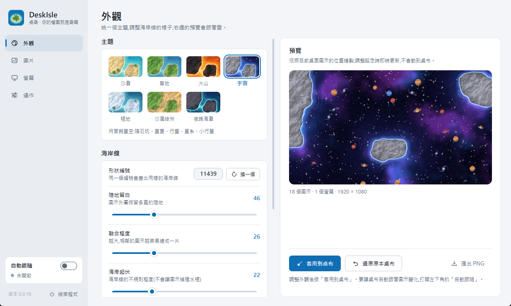
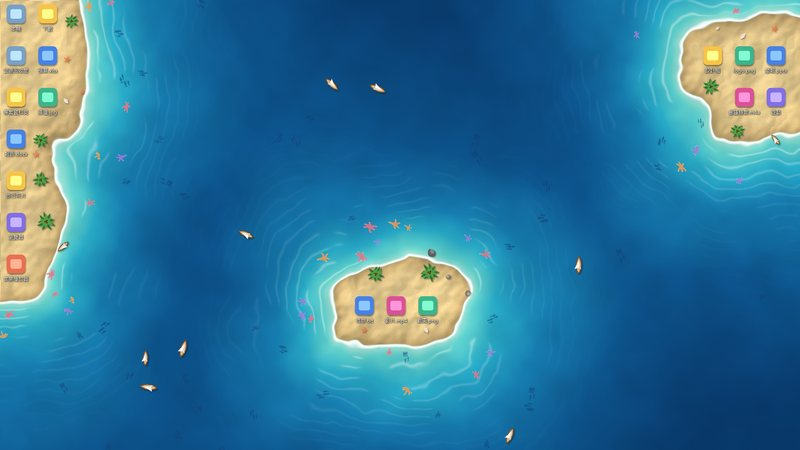
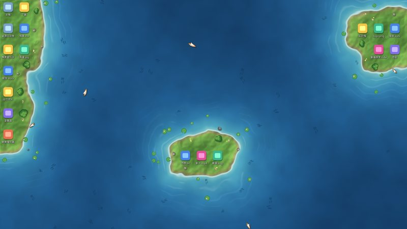
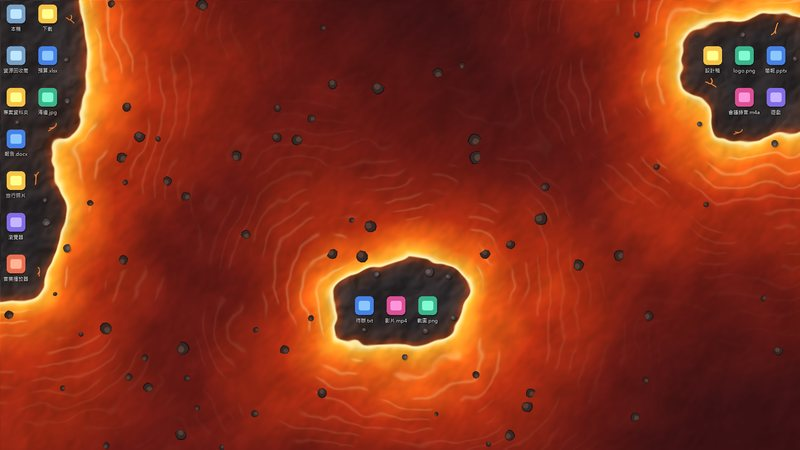
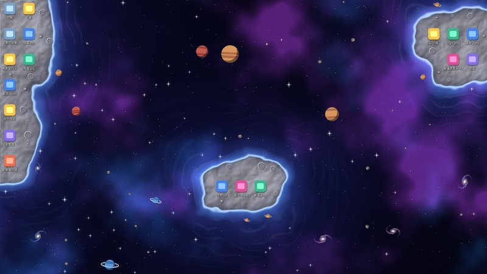
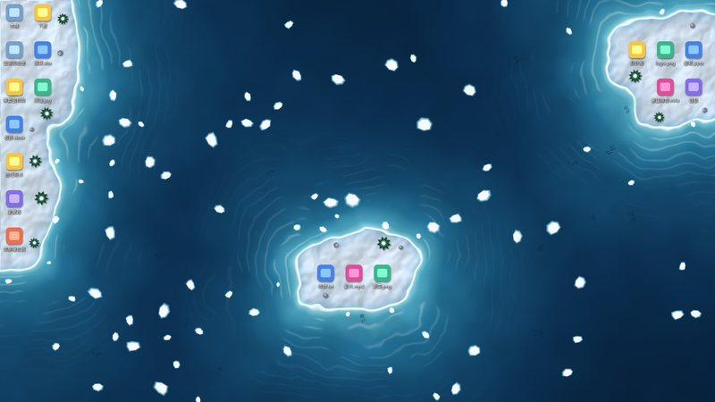
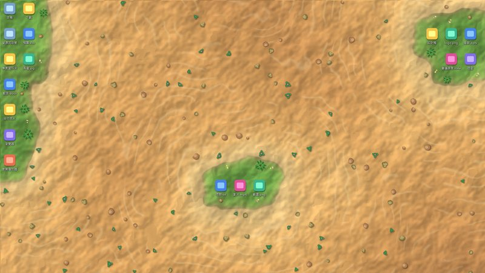
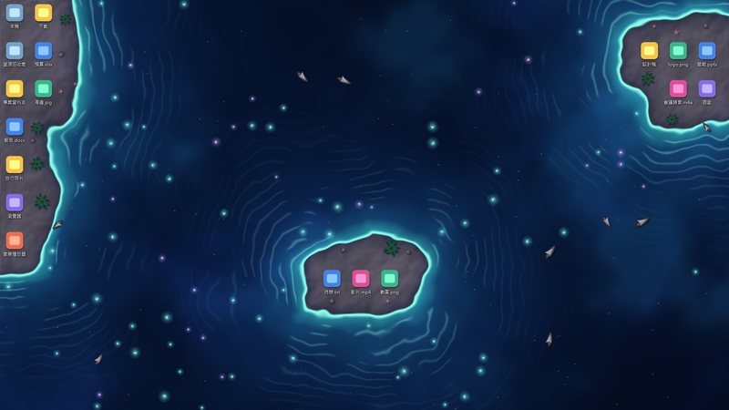

<div align="center">

# 🏝️ DeskIsle 桌島

**你的檔案，就是島嶼。**

一款會跟著桌面圖示長出地形的動態桌布。<br>
有檔案的地方是沙灘，空著的地方是大海——把檔案拖到哪裡，島嶼就長到哪裡。


[**⬇ 下載 DeskIsle.exe**](https://github.com/YCLai0204/DeskIsle/releases/latest)


</div>

---

## ✨ 特色

- **🗺️ 桌面會長出地形**　讀取每個圖示的位置，畫出圍著圖示的島嶼與海岸線。整理桌面，就像在重劃地圖。
- **🔄 自動跟隨**　移動、新增或刪除檔案後，桌布會自動重畫；每次都可以換一種新的海岸線。
- **🎨 七種主題**　沙灘、草地、火山、宇宙、極地、沙漠綠洲、夜晚海灘，每一種都有自己的裝飾物。
- **🐚 看得出檔案類型**　資料夾旁邊長椰子樹、圖片旁邊放貝殼、影音旁邊游著魚……每個主題都有自己的對照。
- **🖼️ 用自己的圖片**　照片可以鋪滿海面、替陸地取色，或上傳去背小圖當成星球、小船散落在桌布上。
- **🌙 日夜自動切換**　白天沙灘、晚上夜晚海灘，時間到了自動換。
- **🖥️ 多螢幕**　可以選擇要換哪幾個螢幕，橫向、直向都支援。
- **🪶 輕巧省電**　閒置時幾乎不吃 CPU，玩遊戲、看影片時自動暫停。

## 🖥️ 簡潔的設定介面

即時預覽，調好了再套用。淺色、深色模式會跟著系統，也可以自己固定。

<picture>
  <source media="(prefers-color-scheme: dark)" srcset="docs/images/app_dark.png">
  
</picture>

## 🎨 七種主題

| | |
|:---:|:---:|
| <br>**沙灘**（預設）<br><sub>沙灘與海洋・椰子樹、貝殼、海星、珊瑚、魚群、小船</sub> | <br>**草地**<br><sub>草地與湖泊・樹、花叢、荷葉、魚群、小船</sub> |
| <br>**火山**<br><sub>玄武岩與熔岩・岩塊、發光裂縫、漂浮岩殼</sub> | <br>**宇宙**<br><sub>月面與星空・隕石坑、行星、星系、星雲</sub> |
| <br>**極地**<br><sub>雪原與極海・雪松、浮冰</sub> | <br>**沙漠綠洲**<br><sub>綠洲與沙丘・椰子樹、仙人掌、砂岩</sub> |
| <br>**夜晚海灘**<br><sub>月光下的沙灘・發光浪花、水母</sub> | |

## 🚀 三步開始

1. **下載並打開** `DeskIsle.exe`，不用安裝，點兩下就能用。
2. **挑一個主題**，用滑桿調整海岸線，右邊會即時預覽，這時還不會動到你的桌布。
3. **按「套用到桌布」**。想讓桌布跟著圖示自動變化，就打開左下角的「**自動跟隨**」。

關掉視窗後，桌島會縮到右下角的系統匣，在背景繼續運作。想完全結束，請在系統匣圖示上按右鍵選「結束 DeskIsle」，
或按視窗左下角的「結束程式」。

> **第一次執行看到 SmartScreen 警告？**<br>
> 這是因為程式還沒有數位簽章。按「其他資訊 → 仍要執行」即可。

## 🧩 更多玩法

<details>
<summary><b>用自己的圖片當海洋、陸地</b></summary>

在左邊的「圖片」頁，海洋和陸地可以各選一張圖片（PNG、JPG、WebP 等），可以同時使用：

| 區塊 | 照片 | 取色 |
|---|---|---|
| 海洋 | 圖片鋪滿海面，海岸邊留一圈淺灘，浪花疊在圖片上 | 用圖片的顏色重新替海上色，浪花、星雲也跟著換色 |
| 陸地 | 圖片鋪在陸地上，海岸留一圈沙灘 | 用圖片的顏色替陸地上色，質感與裝飾物照舊（推薦） |

圖片會複製一份保存，原檔之後刪掉也沒關係。
</details>

<details>
<summary><b>上傳小物件：星球、小船、貼圖</b></summary>

在「圖片」頁的「小物件」上傳小圖（建議用去背的 PNG），它們會像裝飾物一樣散落在桌布上。

- 可以一次加好幾張，選擇放在海上、陸地上，或兩邊都放。
- 可以調整數量和大小，也可以把照片裁成圓形，當成一顆顆星球。
</details>

<details>
<summary><b>依檔案類型擺裝飾物</b></summary>

每個圖示旁邊會放一個代表它檔案類型的裝飾物。以「沙灘」主題為例：

| 資料夾 | 圖片 | 文件 | 捷徑 | 程式 | 影音 |
|:---:|:---:|:---:|:---:|:---:|:---:|
| 椰子樹 | 貝殼 | 海星 | 小船 | 珊瑚 | 魚 |

各主題的對照會顯示在「外觀」頁，不想要也可以關掉。
</details>

<details>
<summary><b>白天、晚上自動換主題</b></summary>

在「運作」頁打開「晚上自動換主題」，選好晚上用的主題與時段（例如 19:00 到隔天 07:00）。
時間到了桌布會自動換成晚上的主題，早上再換回來。這個功能需要打開「自動跟隨」。
</details>

<details>
<summary><b>多螢幕與匯出圖片</b></summary>

- 有多個螢幕時，在「螢幕」頁點選要換桌布的螢幕，沒選的會維持原本的桌布。
- 按預覽下方的「**匯出 PNG**」，可以把目前的樣子存成全尺寸圖片，例如拿去當手機桌布，
  不會動到電腦的桌布。
</details>

## 🪶 輕巧、安靜、離線

桌布是一張靜態圖片，不使用顯示卡，也不會一直在背景動畫。
以下是在 1920×1080、37 個圖示的桌面上實測的數字：

| | |
|---|---|
| 縮在系統匣閒置時 | 約佔單核心 CPU 的 0.1%，記憶體約 30 MB |
| 圖示改變後重畫一次 | 約 0.45 秒 |
| 全螢幕遊戲、影片、螢幕鎖定 | 自動暫停 |

**隱私：** 桌島完全不連網。它只讀取桌面圖示的位置和名稱（用來判斷檔案類型），
所有設定和圖片都存在你自己的電腦裡。

## ↩️ 隨時回到原本的桌布

第一次套用前，桌島會先把你原本的桌布備份起來。按「**還原原本桌布**」就能恢復原狀。

> 如果原本用的是「Windows 焦點」或「幻燈片」，圖片會還原，但自動更換的功能要到
> 設定 → 個人化 → 背景 重新選一次。

## 💻 系統需求

- **Windows 10 / 11**（64 位元）：下載 exe 就能用，不需要安裝 Python 或其他任何東西。
- **macOS**（實驗性）：需要從原始碼執行，見下方說明。

<details>
<summary><b>macOS 使用方式（實驗性，尚未在實機上測試）</b></summary>

```
python3 -m pip install -r requirements.txt
python3 deskisle_app.py
```

- 需要 Python 3.9 以上，而且要有 tkinter（python.org 的安裝程式內建；
  Homebrew 的 Python 要另外 `brew install python-tk`）。
- 第一次執行時 macOS 會問「是否允許控制 Finder」，要按「好」，桌島要靠 Finder
  才能知道桌面圖示的位置。按錯了可以到「系統設定 → 隱私權與安全性 → 自動化」打開。
- 與 Windows 版的差異：
  - 沒有系統匣圖示，關閉視窗時會縮到 Dock。
  - 圖示的外框是依 Finder 的圖示大小估算的，不像 Windows 那麼精確（留白會把誤差蓋過去）。
  - Finder 記錄圖示位置有時會晚幾秒，所以拖動圖示後桌布可能過幾秒才更新（最慢約 10 秒）。
  - 只會改「目前這個桌面空間（Space）」的桌布。
  - 「全螢幕時暫停」在 Mac 上沒有作用。
- 開機啟動是在 `~/Library/LaunchAgents/com.deskisle.app.plist` 放一個登入項目。
- 設定與產生的桌布在 `~/Library/Application Support/DeskIsle/`。

歡迎回報在 Mac 上遇到的問題。
</details>

## ❓ 常見問題

<details>
<summary><b>每次移動圖示，海岸線形狀都不一樣？</b></summary>

這是預設行為，讓桌布每次都有新鮮感。想固定形狀，到「運作」頁關掉「每次換一種海岸線」。
</details>

<details>
<summary><b>關掉視窗後程式還在嗎？</b></summary>

在。桌島會縮到系統匣繼續跟隨你的桌面。要完全結束，請在系統匣圖示上按右鍵選「結束 DeskIsle」，
或按視窗左下角的「結束程式」。
</details>

<details>
<summary><b>會拖慢電腦或耗電嗎？</b></summary>

幾乎不會。只有在圖示改變時才重畫一次，玩遊戲或看影片時會自動暫停。
想更省電，可以在「運作」頁把檢查間隔調長。
</details>

<details>
<summary><b>已知限制</b></summary>

- 多螢幕與非 100% 縮放尚未在實機上完整測試。每個螢幕各自設定桌布需要 Windows 8 以上，
  做不到時會退回「整個桌面畫成一張圖、以跨螢幕模式套用」。
- 只更新部分螢幕時，桌布的「樣式」會統一設成「填滿」。
- 極地主題的雪地顏色偏淺，圖示的白色文字比較不明顯。
- exe 尚未在其他電腦上測試過；macOS 版尚未在實機上測試過。
- 目前的驗證狀態見 [PLAN.md](docs/PLAN.md) 第 13 節。
</details>

## 🛠️ 開發者

- 從原始碼執行、命令列、測試、打包：[docs/DEVELOPMENT.md](docs/DEVELOPMENT.md)
- 完整的設計說明：[docs/PLAN.md](docs/PLAN.md)
